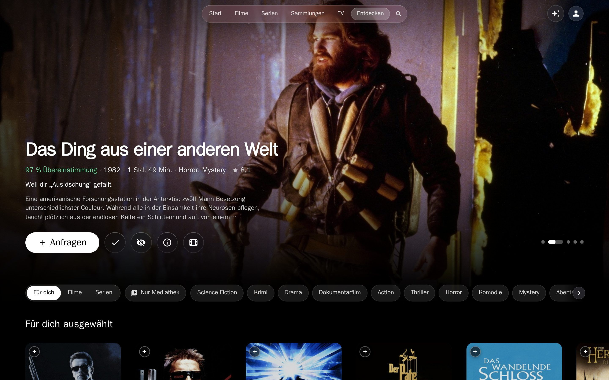
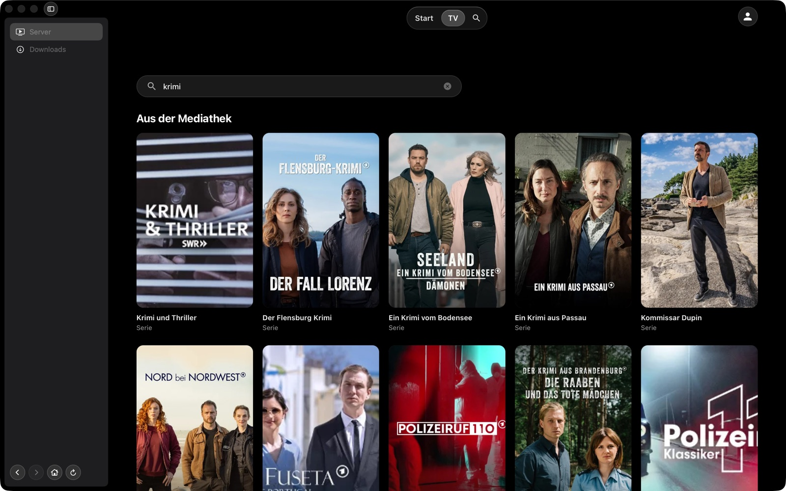
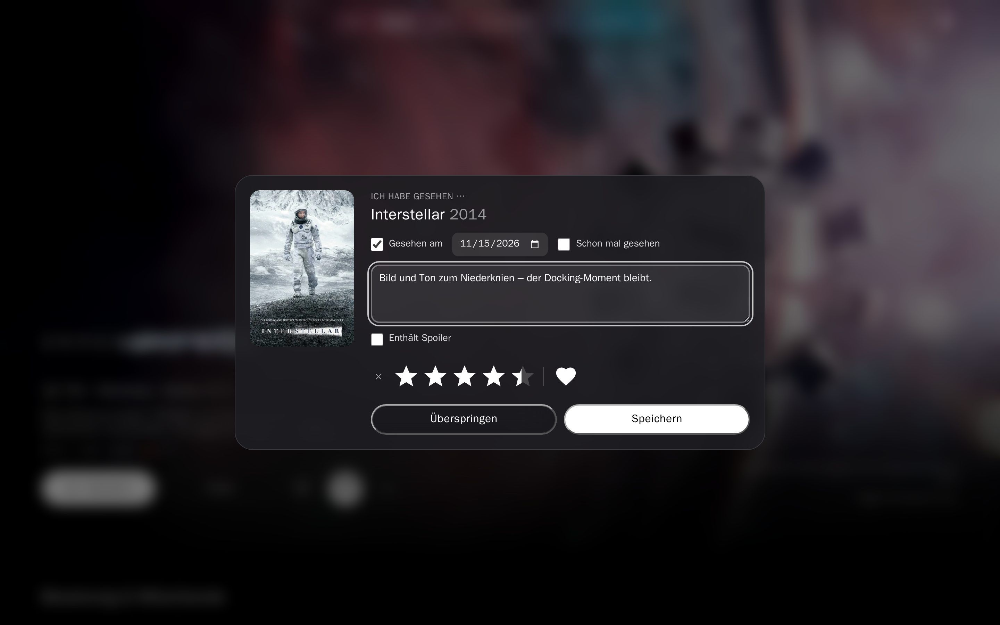

# Plugin-Katalog von derpfiff

<p>
  
  <a href="https://github.com/derpfiff/jellyfin-plugins/actions/workflows/update.yml"></a>
  
</p>

Ein Katalog für alle meine Jellyfin-Plugins. In Jellyfin unter **Dashboard → Plugins → Repositories** diese Adresse eintragen:

```
https://raw.githubusercontent.com/derpfiff/jellyfin-plugins/main/manifest.json
```

| | Plugin | Was es tut |
|---|---|---|
|  | **[Cinema Glass](https://github.com/derpfiff/cinema-glass)** | Glas-Oberfläche im Stil von Apple TV, „Entdecken“ mit persönlichen Empfehlungen, Anfragen über Seerr, Bewerten nach dem Schauen |
|  | **[Mediathek](https://github.com/derpfiff/jellyfin-mediathek)** | ARD Mediathek und Live-TV der öffentlich-rechtlichen Sender im eigenen Server |
|  | **[Jellyscribe (Fork)](https://github.com/derpfiff/jellyscribe-fork)** | Letterboxd-Tagebuch auf Wunsch: trägt nur ein, was im Bewerten-Dialog von Cinema Glass bestätigt wird |

Alle Plugins sind für **Jellyfin 12.4** gebaut. Jedes läuft für sich, zusammen ergänzen sie sich: Cinema Glass macht aus
der Mediathek eine TV-Seite, und mit Jellyscribe landen Bewertungen auf Letterboxd.

## So entsteht der Katalog

GitHub setzt die Datei `manifest.json` stündlich aus den Katalogen der einzelnen Repositories zusammen
(`scripts/merge.py`, Ablauf `.github/workflows/update.yml`). Nach jeder Veröffentlichung läuft der Ablauf zusätzlich
von Hand. Die Einzel-Kataloge der Repositories funktionieren weiter.

Dazu passt die Mac-App [JellyDesk](https://github.com/derpfiff/JellyDesk) mit Downloads und Offline-Wiedergabe.
